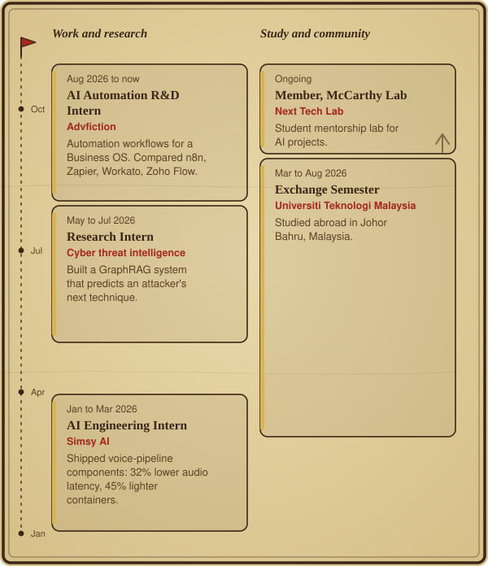
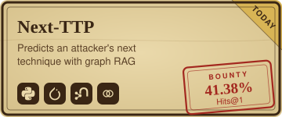
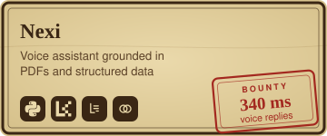
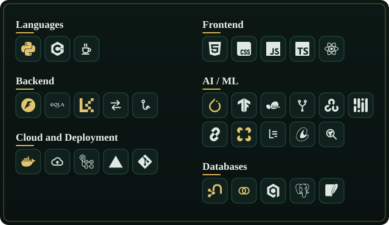

# Yeshwanth Atmakuri

### AI engineer: agents, voice AI and GraphRAG

*I teach AI to retrieve, speak and act.*

3 internships in 2026 across voice AI, security research and automation. 2x Smart India Hackathon internal qualifier.

**Now:** AI Automation R&D Intern at Advfiction. 
<!-- LASTSEEN:START -->*Last seen: pushing to Vectorless-Rag, 12 days ago.*<!-- LASTSEEN:END -->

[**Portfolio**](https://yesh-eosin.vercel.app/) &nbsp;|&nbsp; [**LinkedIn**](https://www.linkedin.com/in/yesh26/) &nbsp;|&nbsp; [**Email**](mailto:atmakuriyeshwanth@gmail.com)

</td>
</tr>
</table>

## Voyage

## Projects

Click a card to open the repo. The gold ribbon marks today's island of the day.

## Armory

Gold marks the tools I use most.

Directions are optional. Shipping is not.

